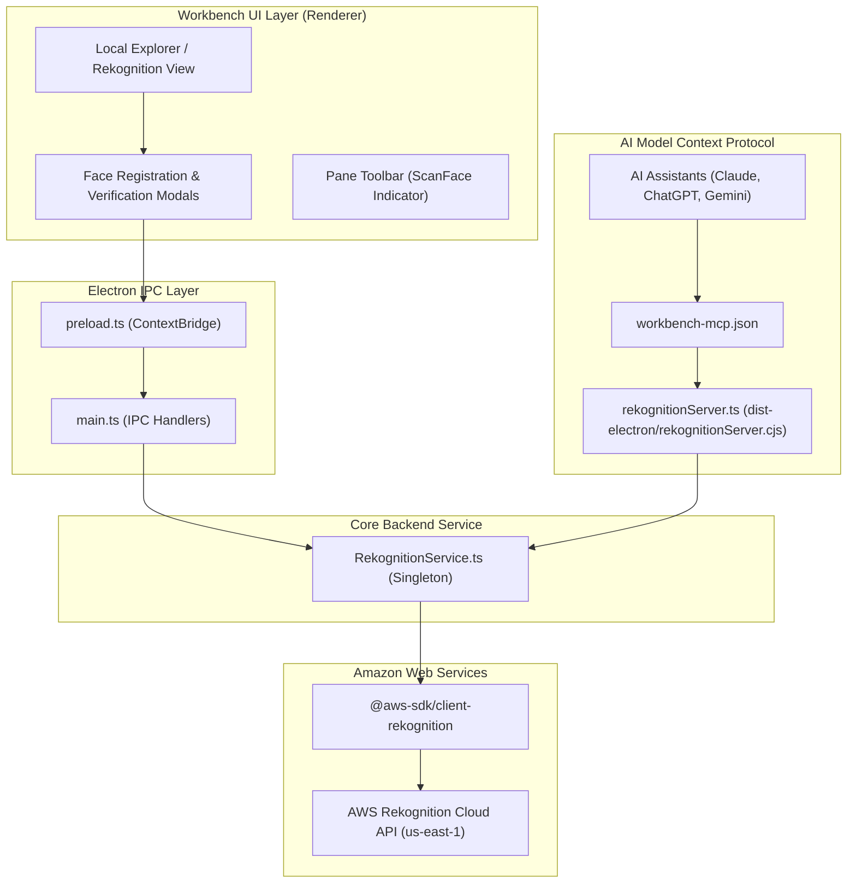

# AWS Rekognition Integration & Feature Specification

**Document:** AWS Rekognition Integration Guide  
**Version:** 1.0  
**Target:** Desktop Technical Reading, AI Synthesis & Knowledge Workspace (`Workbench`)  
**Technology Stack:** AWS SDK for JavaScript v3 (`@aws-sdk/client-rekognition`), Model Context Protocol (MCP), Electron 34, React 19, TypeScript 5.7  
**Repository:** `d:\Products\Workbench`

---

## 1. Executive Summary

This document details the architecture, capabilities, and workflows of the **Amazon Rekognition** integration within Workbench.

Amazon Rekognition is integrated into Workbench to bridge local desktop document engineering and multimodal AI reasoning:
1. **Interactive UI Workflows**: Directly within the **BookView** reader and **Local Explorer**, users can register human faces from local photos into persistent collections and verify unidentified or query images with real-time confidence scores and bounding boxes.
2. **Autonomous AI Assistance via MCP**: Exposes Rekognition as a standardized Model Context Protocol (MCP) tool server (`aws_rekognition`). Connected AI assistants (ChatGPT, Claude, Google Gemini, Grok) can autonomously detect objects/scenes, read text via OCR, and index/search faces to identify people referenced in documents and images.

---

## 2. Architecture & Data Flow



---

## 3. Features Implemented in Workbench Today

The current implementation in Workbench provides 5 primary functional capabilities spanning both interactive UI and AI tool invocation:

| Capability | Method (`RekognitionService`) | MCP Tool Identifier | Primary Use Case |
| :--- | :--- | :--- | :--- |
| **Face Registration** | `addFace()` | `rekognition_add_face` | Extract facial vector embeddings from local images and associate them with a person's name in a collection. |
| **Face Verification & Search** | `checkFace()` | `rekognition_check_face` | Match an unknown/query image against all registered identities in a collection with similarity percentages. |
| **List Faces in Collection** | `listFaces()` | `rekognition_list_faces` | Inspect all indexed faces, person tags, and face IDs stored within a collection. |
| **Object & Scene Detection** | `detectLabels()` | `rekognition_detect_labels` | Detect physical objects, environments, scenery, and activities with confidence percentages. |
| **Image OCR (Text Extraction)** | `detectText()` | `rekognition_detect_text` | Extract printed text, titles, document headers, and diagrams from images without manual retyping. |

---

## 4. Component Details & Implementation

### 4.1 Backend Service: `electron/services/rekognitionService.ts`
The singleton class `RekognitionService` encapsulates all direct AWS SDK interactions:
- **Client Initialization**: Automatically pulls credentials from the local environment (`AWS_ACCESS_KEY_ID`, `AWS_SECRET_ACCESS_KEY`, `AWS_SESSION_TOKEN`) or the AWS shared credentials profile (`~/.aws/credentials`). Default region is `us-east-1` (configurable via `process.env.AWS_REGION`).
- **File Validation & Byte Handling**:
  - Automatically resolves relative or absolute paths.
  - Verifies local file existence.
  - Validates image size against the AWS Rekognition direct payload limit (**5 MB** max for raw bytes).
- **External Image ID Sanitization**: Ensures person names conform to AWS regex constraints (`[a-zA-Z0-9_.\-:]+`) up to 255 characters.

### 4.2 IPC Handlers: `electron/main.ts` & `electron/preload.ts`
The Electron main process registers typed IPC channels:
- `workbench:rekognition-add-face` ➔ `window.electron.rekognitionAddFace()`
- `workbench:rekognition-check-face` ➔ `window.electron.rekognitionCheckFace()`
- `workbench:rekognition-list-faces` ➔ `window.electron.rekognitionListFaces()`

### 4.3 MCP Server: `electron/mcp/rekognitionServer.ts`
A standalone stdio MCP server configured in `workbench-mcp.json`. Compiled by Vite's esbuild step to `dist-electron/rekognitionServer.cjs`.

#### MCP Tool Schemas:
1. **`rekognition_add_face`**:
   - `imagePath` *(string, required)*: Path to image file (`.jpg`, `.jpeg`, `.png`, `.webp`).
   - `personName` *(string, optional)*: Name of the person to associate.
   - `collectionId` *(string, optional, default: `"workbench-faces"`)*: Destination collection.
2. **`rekognition_check_face`**:
   - `imagePath` *(string, required)*: Path to query image.
   - `collectionId` *(string, optional, default: `"workbench-faces"`)*: Target collection.
   - `matchThreshold` *(number, optional, default: `85`)*: Minimum similarity score (50–99).
3. **`rekognition_list_faces`**:
   - `collectionId` *(string, optional, default: `"workbench-faces"`)*: Collection to inspect.
4. **`rekognition_detect_labels`**:
   - `imagePath` *(string, required)*: Path to image file.
   - `maxLabels` *(number, optional, default: `20`)*: Maximum labels returned.
   - `minConfidence` *(number, optional, default: `70`)*: Minimum confidence threshold.
5. **`rekognition_detect_text`**:
   - `imagePath` *(string, required)*: Path to image file for OCR.

### 4.4 UI Integration: `src/components/LocalExplorer.tsx`
- **Rekognition Platform Source**: Accessible from the BookView platform selector (shows the `ScanFace` icon and distinct badge).
- **Sidebar Actions**:
  - **Register / Add Face**: Launches a modal dialog allowing users to index the selected image into any specified collection with a custom person name.
  - **Verify / Check Face**: Launches a verification modal with an adjustable match threshold slider (50% to 99%).
- **Interactive Results Box**:
  - Displays match confirmation or failure with high-contrast badge styling.
  - Lists matched person names, face IDs, and similarity scores.

---

## 5. Configuration & Authentication Setup

AWS Rekognition requires valid AWS credentials with permissions for the `rekognition:*` action set.

### 5.1 Setting Up AWS Credentials
Workbench leverages standard AWS SDK credential resolution:
1. **Environment Variables**:
   ```bash
   AWS_ACCESS_KEY_ID="your-access-key-id"
   AWS_SECRET_ACCESS_KEY="your-secret-access-key"
   AWS_REGION="us-east-1"
   ```
2. **Shared Credentials File**:
   Configured in `~/.aws/credentials`:
   ```ini
   [default]
   aws_access_key_id = your-access-key-id
   aws_secret_access_key = your-secret-access-key
   ```
   Configured in `~/.aws/config`:
   ```ini
   [default]
   region = us-east-1
   ```

### 5.2 IAM Policy Minimum Permissions
To run the Workbench Rekognition features, the IAM identity needs the following policy:

```json
{
  "Version": "2012-10-17",
  "Statement": [
    {
      "Sid": "WorkbenchRekognitionAccess",
      "Effect": "Allow",
      "Action": [
        "rekognition:IndexFaces",
        "rekognition:SearchFacesByImage",
        "rekognition:ListFaces",
        "rekognition:DetectLabels",
        "rekognition:DetectText",
        "rekognition:CreateCollection",
        "rekognition:DescribeCollection"
      ],
      "Resource": "*"
    }
  ]
}
```

---

## 6. Complete AWS Rekognition Platform Capabilities

The table below outlines the broader capabilities provided by the Amazon Rekognition cloud platform that are available for future extension into Workbench:

### 6.1 Facial Analysis & Demographics
- **Facial Attributes & Emotions**: Detection of emotions (happy, sad, calm, surprised, confused, angry, disgusted), smile confidence, estimated age brackets, and eyes open/closed.
- **Direct 1:1 Face Comparison (`CompareFaces`)**: Immediate comparison between two distinct image files without needing to create or maintain a vector collection.
- **Face Liveness Detection**: Real-time challenge/response analysis to detect spoofing attempts (e.g. photos of screens, printed pictures, 3D masks) in authentication workflows.

### 6.2 Visual Content Moderation & Safety
- **Content Moderation (`DetectModerationLabels`)**: Automatically flags explicit, suggestive, violent, or hate-related imagery across granular taxonomies with confidence scores.
- **Personal Protective Equipment (PPE) Detection**: Analyzes worker safety gear compliance (helmets, face masks, protective vests, safety gloves) on identified person bodies.

### 6.3 Custom Models (Custom Labels)
- **Rekognition Custom Labels**: Train bespoke lightweight computer vision models with no machine learning coding. Enables Workbench to identify specialized engineering components, architectural symbols, corporate logos, or bespoke hardware from user-provided training sets.

### 6.4 Video Analysis (Stored & Streaming)
- **Live Video Ingestion via Kinesis Video Streams**: Real-time face tracking and identification on live camera feeds.
- **Stored Video Indexing**: Timeline analysis for scene transitions, person paths, OCR text in video frames, and technical cues (closing credits, black frames).

---

## 7. Operational Limits & Technical Guidelines

- **Image Format Support**: Amazon Rekognition natively supports `.jpeg`, `.jpg`, and `.png`. Workbench also allows `.webp` (converted or passed where supported).
- **Direct Image Size Limit**: The maximum direct image payload sent as raw bytes to Amazon Rekognition is **5 MB**. Images exceeding 5 MB must either be resized client-side or staged via Amazon S3 (up to 15 MB).
- **Image Resolution**: Recommended minimum resolution for face detection is 80x80 pixels. High-resolution photos (up to 4096x4096) provide optimal feature vector extraction.
- **Collection Quotas**: Collections are vector indexes maintained per AWS region. A single collection can store millions of face vectors.
