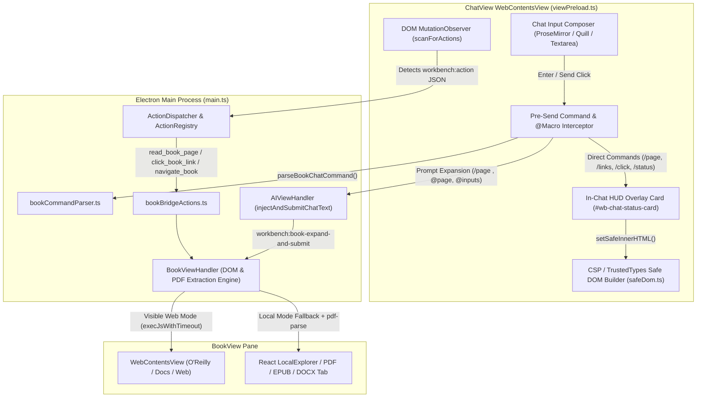

# Workbench — ChatView ↔ BookView Bridge Architecture & Command Guide

**Version:** 1.0  
**Target:** Bidirectional Extraction, Interactive Link Navigation, & Autonomous AI Control Between ChatView and BookView  
**Platforms:** Windows 10/11 & macOS (Universal)  
**Supported AI Providers:** Anthropic Claude (`claude.ai`), Google Gemini (`gemini.google.com`), OpenAI ChatGPT (`chatgpt.com`), xAI Grok (`grok.com`), and Custom Web Chat Providers  

---

## 1. Executive Summary

The **ChatView ↔ BookView Bridge** connects the AI Chat pane (`AIViewHandler` / `viewPreload.ts`) with the BookView pane (`BookViewHandler` / `BookPane.tsx` / `LocalExplorer.tsx`) so users and primed AI models can:

1. **Extract Visible Content & Form Inputs**: Pull the currently visible viewport text, full chapter/document text, highlighted selections, interactive links, and form input values directly from BookView into ChatView.
2. **Click Links & Buttons Inside BookView**: Index clickable elements with visual `#id` badges in BookView and click any link, button, or Table of Contents entry by `#id` or text match directly from ChatView.
3. **Navigate & Scroll BookView**: Scroll up/down, jump to top/bottom, navigate to next/previous chapters, or go back/forward in BookView history from ChatView.
4. **Support Both Web Books & Local Books/PDFs**: Automatically reads from the live BookView `WebContentsView` when viewing web platforms (O'Reilly, Packt, Manning, Red Hat, web docs) and falls back to the active Local Book tab (including `pdf-parse` text extraction for local PDFs) when BookView is in Local Books mode.

---

## 2. System Architecture

The bridge uses a **3-Layer Hybrid Architecture** combining instant client-side slash commands/macros (no priming required) with autonomous `workbench:action` tools (when primed):



---

## 3. Complete ChatView Command Reference

### 3.1 Do You Need Priming?

| Workflow | Needs Priming (⚡ Connect to AI)? | How It Works |
| :--- | :---: | :--- |
| **Slash Commands** (`/page`, `/links`, `/click`, `/book`, `/status`) | **No** | Intercepted locally in `viewPreload.ts` before the message is sent to the AI. Works immediately in any chat. |
| **Inline `@` Macros** (`@page`, `@chapter`, `@inputs`, `@links`, `@selection`) | **No** | Automatically expands the live BookView content into your prompt and submits it to the AI in one step. |
| **Natural Language AI Requests** (*"Read the book page and click Chapter 3"*) | **Yes** (`⚡` or `/connect`) | Priming teaches the AI the `workbench:action` JSON schemas (`read_book_page`, `list_book_links`, `click_book_link`, `navigate_book`). |

> [!TIP]
> Every `/` command also supports `!` or `wb:` prefixes (for example, `!page`, `!links`, `!click Next`, `!status`, `wb:page`) in case an AI site binds `/` to its own native menu.

---

### 3.2 Instant HUD & Extraction Commands (No Priming Needed)

Type these alone in the ChatView input box and press **Enter** (or click **Send**):

| Command | Aliases | Description |
| :--- | :--- | :--- |
| `/page` | `!page`, `/read-page`, `wb:page` | Extracts the **currently visible viewport** from BookView and opens an interactive preview card with 1-click **Explain Page**, **Summarize**, **Extract Inputs**, **Insert in Prompt**, and **Links** buttons. |
| `/chapter` | `!chapter`, `/fullpage`, `wb:chapter` | Extracts the **entire chapter/article or local PDF text** from BookView into the interactive preview card. |
| `/inputs` | `!inputs`, `/forms`, `wb:inputs` | Extracts all visible **form inputs, textboxes, selects, checkboxes, and code/config fields** from BookView. |
| `/status` | `!status`, `wb:status` | Displays the live Workbench connection status card and active workspace target. |
| `/connect` | `!connect`, `/prime`, `!prime` | Primes the active AI chat with Workbench's autonomous action capabilities. |
| `/help` | `!help`, `/commands`, `/book help`, `wb:help` | Opens the interactive in-chat **Command & Summarization Style Reference Card** with 1-click launchers. |

---

### 3.3 Prompt Expansion Commands & Inline `@` Macros (No Priming Needed)

Combine a command or `@` macro with your own instructions to automatically attach live BookView content and send it to the AI:

| Command / Macro Example | What Gets Sent to the AI |
| :--- | :--- |
| `/page Explain this section in simple terms` | Extracts the visible BookView viewport text and sends it with your instruction. |
| `/chapter Create a structured study guide from this chapter` | Extracts the full BookView chapter/PDF text and sends it with your instruction. |
| `/inputs Generate a valid JSON payload for these fields` | Extracts all form inputs/labels/values from BookView and sends them with your instruction. |
| `Compare @page with best practices` | Replaces `@page` inline with the live visible BookView snapshot. |
| `Summarize @chapter and list key formulas` | Replaces `@chapter` (or `@fullpage`) with the full BookView page/PDF text. |
| `Validate the configuration in @inputs` | Replaces `@inputs` with all detected form inputs on the BookView page. |
| `Which link in @links covers authentication?` | Replaces `@links` with the numbered list of clickable links on the BookView page. |
| `/Explain @selection with a Python example` | Replaces `@selection` with the text currently highlighted in BookView. |

---

### 3.4 Controlling Summarization & Explanation Styles

You can control the exact structure, depth, and format of both **Summarize** (*"What does the page say?"*) and **Explain** (*"How & why does it work?"*) in **3 ways**:

#### A. Built-in Summarization Style Flags (`/chapter summarize:<style>` or `/page summarize:<style>`)
| Command | Aliases | What It Produces |
| :--- | :--- | :--- |
| `/chapter summarize` | `/page summarize` | **Structured Technical Summary** (or your customized `Summarize` template from **⚙️ Customize Ask AI Templates**): Core Concept, Key Mechanics, Concrete Example Walkthrough, and Key Takeaways. |
| `/chapter summarize:brief` | `:tldr`, `:short`, `:quick` | **Executive TL;DR**: 1-sentence core thesis + 3–5 concise takeaway bullets. |
| `/chapter summarize:deep` | `:detailed`, `:thorough`, `:technical` | **Deep Technical Summary**: Comprehensive section-by-section breakdown preserving all definitions, invariants, examples, and complexity bounds. |
| `/chapter summarize:steps` | `:algo`, `:walkthrough`, `:trace` | **Step-by-Step / Algorithm Summary**: Goal & inputs/outputs, state/index variables (`i`, `j`, `k`), step-by-step execution trace on the page's example, and edge cases. |
| `/chapter summarize:study` | `:notes`, `:cheatsheet`, `:guide` | **Study Guide & Cheat Sheet**: Core mental model, key definitions/rules, worked example summary, common pitfalls, and 3 self-test questions with answers. |
| `/chapter summarize:table` | `:matrix`, `:compare` | **Structured Reference Table**: Organizes concepts, variables, or trade-offs into a clean Markdown table. |

#### B. Built-in Explanation Style Flags (`/chapter explain:<style>` or `/page explain:<style>`)
| Command | Aliases | What It Produces |
| :--- | :--- | :--- |
| `/chapter explain` | `/page explain` | **Structured Pedagogical Explanation** (or your customized `Explain` template): Intuition & Big Picture, Step-by-Step Mechanism, Why It Works (Invariants & Rationale), Concrete Walkthrough, and Misconceptions. |
| `/chapter explain:eli5` | `:intuition`, `:simple`, `:analogy` | **Intuition & Real-World Analogy**: Plain-English real-world analogy first, then mapped directly to each technical variable/step on the page. |
| `/chapter explain:why` | `:first-principles`, `:invariant`, `:rationale` | **Why It Works / First Principles**: Core problem, key invariants that hold at every step, and why breaking those assumptions fails. |
| `/chapter explain:trace` | `:walkthrough`, `:dryrun`, `:step` | **Interactive State Trace**: Concrete small input dry-run showing exact variable/pointer/array state before and after every step. |
| `/chapter explain:code` | `:impl`, `:example` | **Code & Line-by-Line Walkthrough**: Clean commented implementation, line-by-line annotation, and trace on a sample input. |
| `/chapter explain:compare` | `:tradeoffs`, `:vs`, `:alternatives` | **Compare & Trade-offs**: Time/space complexity and design trade-offs vs. alternative approaches, plus when to use vs. avoid. |
| `/chapter explain:pitfalls` | `:bugs`, `:edgecases`, `:gotchas` | **Common Pitfalls & Edge Cases**: Off-by-one/boundary mistakes, subtle input edge cases (empty, duplicates), and how to guard against them. |

> **Combining a Style Flag with Extra Focus:** You can add extra instructions right after any style flag—for example:  
> `/chapter summarize:steps focus on how indices i, j, and k advance`  
> `/chapter explain:why focus on why the loop invariant holds`

#### C. 1-Click Summarize & Explain Subsections on the `/page` & `/chapter` HUD Card
Type `/chapter` or `/page` alone and press **Enter** to open the HUD preview card in ChatView. The card displays two dedicated subsections:
- **📝 Summarize:** `📝 Default`, `⚡ Brief TL;DR`, `🔬 Deep Dive`, `🔢 Step-by-Step`, `🎓 Study Notes`, `📊 Table / Matrix`
- **💡 Explain:** `💡 Default`, `🧒 Intuition / ELI5`, `🧠 Why It Works`, `🔍 Dry-Run Trace`, `💻 Code Walkthrough`, `⚖️ Trade-offs`, `⚠️ Pitfalls & Bugs`
- Plus any custom templates you add in **⚙️ Customize** (`AskAITemplateModal`).

---

### 3.5 Link Clicking & Navigation Commands (No Priming Needed)

Control BookView directly from the ChatView prompt box without leaving your keyboard:

| Command | Aliases / Examples | Description |
| :--- | :--- | :--- |
| `/links` | `!links`, `/book-links` | Scans BookView, overlays numbered green `#1`, `#2`, `#3...` badges on clickable links/buttons inside BookView, and opens a clickable link directory in ChatView. |
| `/links <filter>` | `/links Chapter`, `/links API` | Filters BookView links by keyword and highlights matching badges. |
| `/click #<id>` | `/click #3`, `!click 3` | Clicks badge `#3` inside BookView. |
| `/click <text>` | `/click Next`, `/click Table of Contents` | Fuzzy-matches and clicks the link or button matching `<text>` inside BookView. |
| `/next` | `!next`, `/book next` | Clicks the Next Chapter / Next Page button in BookView (or scrolls down a page if none exists). |
| `/prev` | `!prev`, `/book prev` | Clicks the Previous Chapter / Previous Page button in BookView. |
| `/scroll-down` | `/book down`, `!scrolldown` | Scrolls BookView down by 80% of the viewport height. |
| `/scroll-up` | `/book up`, `!scrollup` | Scrolls BookView up by 80% of the viewport height. |
| `/book top` | `/scroll-top` | Scrolls BookView to the top of the page. |
| `/book bottom` | `/scroll-bottom` | Scrolls BookView to the bottom of the page. |
| `/book back` | `!book back` | Navigates back in BookView browser history. |
| `/book forward` | `!book forward` | Navigates forward in BookView browser history. |
| `/book reload` | `!book reload` | Reloads the current BookView page. |
| `/book url <url>` | `/book https://...` | Navigates BookView to the specified URL. |
| `/badges` | `/unbadge`, `/hide-badges` | Shows or clears the numbered `#id` link badges in BookView. |

---

## 4. Autonomous AI Actions (When Primed via ⚡ / `/connect`)

Once a chat is primed, you can ask the AI in plain English (e.g., *"Read the current book page and tell me the list of sections"* or *"Click on Chapter 4 in the book view"*). The AI emits `workbench:action` JSON blocks that Workbench executes automatically:

### 4.1 `read_book_page`
Extracts visible text, full text, headings, form inputs, and interactive links from the active BookView page (or open Local Book/PDF tab).

```json
{
  "action": "read_book_page",
  "scope": "viewport",
  "includeLinks": true,
  "includeInputs": true
}
```
- `scope`: `"viewport"` (default), `"full"`, or `"inputs"`

### 4.2 `list_book_links`
Lists clickable links/buttons in BookView and optionally renders visual `#id` badges on the BookView page.

```json
{
  "action": "list_book_links",
  "filter": "Chapter",
  "viewportOnly": false,
  "showBadges": true
}
```

### 4.3 `click_book_link`
Clicks a link, button, or TOC item in BookView by badge `id` or fuzzy `text` match, waits for navigation/DOM settlement, and returns the updated page title and URL.

```json
{
  "action": "click_book_link",
  "id": 4,
  "text": "Chapter 2: Getting Started"
}
```

### 4.4 `navigate_book`
Scrolls or navigates BookView.

```json
{
  "action": "navigate_book",
  "command": "next"
}
```
- `command`: `"scroll-down"` | `"scroll-up"` | `"scroll-top"` | `"scroll-bottom"` | `"next"` | `"prev"` | `"back"` | `"forward"` | `"reload"` | `"home"` | `"url"` | `"show-badges"` | `"clear-badges"`

---

## 5. Cross-Platform & Google Gemini (`gemini.google.com`) Engineering Notes

Several platform-specific protections are built into the bridge so that commands, HUD cards, and autonomous action blocks work reliably across Claude (`claude.ai`), Google Gemini (`gemini.google.com`), ChatGPT (`chatgpt.com`), and Grok (`grok.com`):

1. **TrustedTypes CSP Compliance (`electron/utils/safeDom.ts`)**:
   - Google Gemini enforces a strict Content Security Policy: `require-trusted-types-for 'script'`. Any direct assignment to `element.innerHTML = ...` in a preload script throws `TypeError: Failed to set the 'innerHTML' property on 'Element': This document requires 'TrustedHTML' assignment`.
   - All Workbench HUD overlays, streaming badges, action badges, and result cards use `setSafeInnerHTML(container, html)` in `electron/utils/safeDom.ts`, which constructs DOM nodes via `document.createElement`, `document.createElementNS`, `document.createTextNode`, and `element.setAttribute` without touching `.innerHTML`.

2. **Streaming `<code-block>` Guard on Gemini (`electron/views/viewPreload.ts`)**:
   - Gemini wraps code snippets inside custom `<code-block>` elements and streams tokens incrementally.
   - In `checkAndExecuteAction()`, if `extractActionsFromText()` encounters an `Incomplete or unclosed JSON block` (`depth > 0`) with no completed payload yet, it defers marking `data-workbench-executed="true"` and re-polls every `250ms` (up to `8000ms`) until the closing `}` arrives. This prevents partial streamed JSON chunks from prematurely poisoning `<code-block>` before streaming completes.
   - In `extractActionsFromText()`, quote tracking (`inString`) only activates when `depth > 0` (inside `{ ... }`), ensuring stray quotes in header labels never disrupt JSON extraction.

3. **Quill Editor & Large Prompt Injection (`electron/views/aiViewHandler.ts`)**:
   - Gemini uses an Angular `<rich-textarea>` wrapping a Quill `div.ql-editor[contenteditable="true"]` editor and a `button.send-button` submit control.
   - For prompts larger than `300` characters (such as expanded `/page` or `read_book_page` outputs), `injectAndSubmitChatText()` uses native Chromium clipboard paste (`webContents.paste()`) and dispatches lightweight `input`/`change` events without passing multi-kilobyte strings into `document.execCommand('insertText')`, preventing renderer thread freezes.

4. **Synthetic `Escape` & Self-Mutation Isolation (`electron/views/viewPreload.ts`)**:
   - `clearInputField()` dispatches a synthetic `Escape` key event strictly on the input element to close slash-command popups, while the global `Escape` cancellation listener checks `if (!e.isTrusted) return` so synthetic cleanup events never cancel the autonomous action loop.
   - The `MutationObserver` ignores mutations originating inside Workbench's own UI nodes (`#wb-chat-status-card`, `.wb-streaming-badge`, `.workbench-action-badge`, `.workbench-action-result-card`, `#workbench-selection-bubble-host`) to prevent self-triggering observation loops.
   - A top-level idempotency flag (`window.__workbenchViewPreloadInitialized`) prevents duplicate observer/listener registration when both `session.setPreloads` and `webPreferences.preload` reference `viewPreload.cjs`.

---

## 6. Key Source Files

| File | Responsibility |
| :--- | :--- |
| `electron/views/bookViewHandler.ts` | DOM extraction (`extractVisiblePage`), link indexing (`extractAndIndexLinks`), badge overlay (`renderOrClearBadges`), element clicking (`clickLinkOrElement`), navigation (`scrollOrNavigate`), `execJsWithTimeout`, and Local Book / PDF (`pdf-parse`) fallback. |
| `electron/actions/bookBridgeActions.ts` | Action handlers for `read_book_page`, `list_book_links`, `click_book_link`, and `navigate_book`. |
| `electron/utils/bookCommandParser.ts` | Parser for `/page`, `/chapter`, `/inputs`, `/links`, `/click`, `/book`, `/status`, `/connect`, `!`/`wb:` prefixes, and inline `@page`, `@chapter`, `@inputs`, `@links`, `@selection` macros. |
| `electron/utils/safeDom.ts` | TrustedTypes / CSP-safe DOM builder (`setSafeInnerHTML`, `decodeHtmlEntities`). |
| `electron/views/viewPreload.ts` | Pre-send command & macro interceptor, interactive HUD cards, streaming `<code-block>` action observer, and in-chat result cards. |
| `electron/views/aiViewHandler.ts` | Multi-platform prompt injection and submission (`injectAndSubmitChatText`) and action feedback loop orchestration. |
| `test/bookBridgeActions.test.ts` | Automated unit & integration test suite for the ChatView ↔ BookView bridge, command parser, and `setSafeInnerHTML`. |

