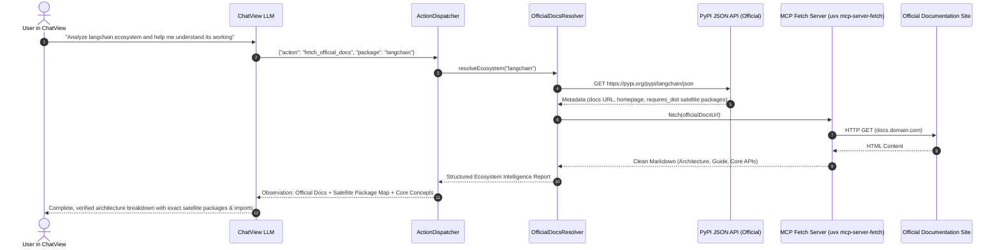

# Documentation-First Package & Ecosystem Intelligence Design

## 1. Overview & Motivation

When software engineers and AI assistants research Python packages, simply running `pip install <package>` or inspecting top-level modules often fails for modern, modular ecosystems:
* **Facade / Meta-packages**: Modern frameworks like `langchain` maintain an empty or lazy top-level `__init__.py` where `dir(package) == []`. The real abstractions live across 10+ satellite packages (`langchain-core`, `langchain-community`, `langgraph`).
* **Resource Bloat**: Installing large ecosystems into local virtual environments requires gigabytes of wheels, binary C extensions, and compilation dependencies.
* **Source of Truth Disconnect**: The single source of truth for an ecosystem's architecture, package breakdown, and API design is its **official documentation website** (e.g., `python.langchain.com`, `docs.pydantic.dev`, `fastapi.tiangolo.com`), not random third-party blogs or blind local installations.

The **Documentation-First Package Intelligence Feature** provides a zero-installation, verified ecosystem analysis engine initiated directly from **ChatView** and powered by official PyPI metadata and the Model Context Protocol (**MCP**).

---

## 2. Architecture & Data Flow

---

## 3. Core Components

### 3.1. Official Documentation Resolver (`electron/services/officialDocsResolver.ts`)
* **Registry Querying**: Queries `https://pypi.org/pypi/<package>/json` with strict 8-second timeout and caching.
* **URL Hierarchy Normalization**:
  1. `info.project_urls.Documentation`
  2. `info.project_urls.Docs`
  3. `info.docs_url`
  4. `info.project_urls.Homepage` / `info.home_page`
  5. `info.project_urls.Source` / `info.project_urls.Repository` (GitHub)
* **Satellite Package Mapping**:
  * Parses `info.requires_dist` to identify related packages within the same ecosystem (e.g. `langchain-core`, `langchain-community`, `langchain-openai`, `langgraph`).
  * Classifies packages into **Core / Foundation**, **Integrations / Providers**, and **Utilities**.
* **Package Name Normalization**: Handles PyPI hyphenated distribution names vs. Python underscored import identifiers (`langchain-core` → `langchain_core`).

### 3.2. Official Documentation Fetch via MCP (`electron/actions/fetchOfficialDocsAction.ts`)
* Uses Workbench's active `mcp-server-fetch` (already running via `uvx mcp-server-fetch`) or in-process HTTPS fallback with Readability/Markdown conversion.
* Strips navigation headers, footers, cookie banners, and script tags to retain dense, token-efficient architecture guides and API tables.
* Caps documentation excerpts to 15,000 characters to fit within LLM observation context without truncating vital architectural details.

### 3.3. Action Registry & ChatView Tool Integration (`electron/actions/registry.ts`)
* Exposes `fetch_official_docs` under the `⚡ Batch & Script Execution` group (`defaultSelected: true`).
* Aliases: `analyze_package_ecosystem`, `inspect_package_docs`, `official_docs_lookup`, `package_docs`, `get_official_docs`.
* Parameters:
  * `package` (string, required): The package or ecosystem name (e.g. `"fastapi"`, `"langchain"`, `"pydantic"`).
  * `format` (string, optional): ID of output format template to follow (default: `"package-architecture"`).
  * `fetchDocs` (boolean, optional): Whether to scrape official docs content (default: `true`).
  * `saveNote` (boolean, optional): Whether to persist the generated report to `notes/<package>-architecture.md` (default: `false`).

### 3.4. File-Driven Output Format Template System (`electron/services/outputFormatService.ts`)
Rather than hardcoding output schemas into TypeScript strings, format prescriptions are managed as standalone `.format.md` files:
* **Template Search Precedence**:
  1. `<workspace>/.workbench/formats/<id>.format.md` (User workspace overrides)
  2. `<workspace>/templates/formats/<id>.format.md` (Repository template definitions)
  3. `<cwd>/.workbench/formats` & `templates/formats`
  4. App bundle default templates
* **Live Inspection & Editing**: Users can open, edit, and create custom formats directly inside NoteView without recompiling TypeScript or restarting the app.
* **Default Blueprint (`package-architecture.format.md`)**:
  1. **Conceptual Anchor**: Application archetype, core boilerplate-reduction paradigm, and 5-stage runtime request journey.
  2. **Component Hierarchy**: ASCII/Mermaid tree of nesting runtime elements from root application down to individual operations.
  3. **Framework Nuances**: Concurrency execution rules (async vs sync threadpools), modern lifespan state management, scoping & state traps.
  4. **Canonical Production Blueprint**: Modern, idiomatic Python code with lifespans, grouped routers, type contracts, and dependency injection.
  5. **Documentation Deep-Links Atlas**: Direct chapter links to high-yield documentation topics.

---

## 4. Verification & Testing Strategy

1. **Unit Tests (`test/official_docs.test.ts`)**:
   * PyPI metadata parsing for multi-package ecosystems (`langchain`).
   * Satellite package extraction from `requires_dist`.
   * Documentation URL extraction and prioritization.
   * Action error handling for nonexistent packages.
2. **End-to-End ChatView Verification**:
   * Asking ChatView to inspect `langchain`, `pydantic`, or `faststream`.
   * Verifying that the AI receives the verified official documentation URL and constituent satellite packages without local installation.
