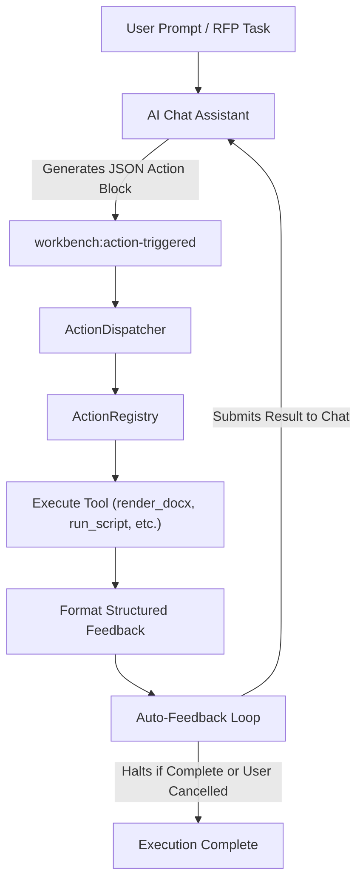

# Workbench — Complete Feature List & Capability Catalog

**Document:** System Feature Catalog  
**Version:** 2.0  
**Target:** Desktop Technical Reading, AI Synthesis & Knowledge Workspace  
**Technology Stack:** Electron 34, React 19, TypeScript 5.7, Vite 6  
**Repository:** `d:\Products\Workbench`

---

## Executive Summary

Workbench is a desktop technical workspace designed for engineers, researchers, and technical writers. It unifies high-yield technical reading platforms (O'Reilly, Kindle, EPUB/MOBI, PDF, Office documents) with multi-provider generative AI assistants (ChatGPT, Claude, Gemini, Perplexity, DeepSeek) and personal knowledge management systems (OneNote, local Markdown, and companion reading notebooks). 

Through an autonomous **Workbench Action Model** and **Model Context Protocol (MCP)** integration, the AI assistant can directly interact with documents, execute code, process RFPs, and manage files safely within the local environment.

---

## 1. Tri-Pane Workspace & Native Layout Engine

Workbench organizes the desktop workspace into three synchronized, persistent panes:

| Pane | Role | Supported Sources & Environments |
| :--- | :--- | :--- |
| **BookView (Left Pane)** | Deep Technical Reading | • Cloud Reading: O'Reilly Learning, Kindle Cloud Reader, Safari Books<br>• Local Document Reader: EPUB, MOBI/AZW/PRC, PDF, DOCX, XLSX/XLS/CSV, Text/Code |
| **ChatView (Top-Right Pane)** | AI Synthesis & Automation | • Cloud Assistants: ChatGPT, Claude, Google Gemini, Perplexity, DeepSeek<br>• Workbench Action Engine & MCP tool execution |
| **NoteView (Bottom-Right Pane)** | Knowledge Management | • Cloud Notebooks: Microsoft OneNote Web, Notion, Evernote<br>• Local Explorer: File tree, companion notes, code viewer, markdown editor |

### Key Layout & Geometry Features
- **Dual-Axis Continuous Splitters**:
  - Horizontal column splitter adjusts Left (Reading) vs. Right (Chat + Notes) from 15% to 85% width.
  - Vertical row splitter adjusts ChatView vs. NoteView from 15% to 85% height.
- **60 FPS Ghost Dragging**:
  - Prevents Chromium redraw lag during splitter motion by moving native `WebContentsView` surfaces off-screen and rendering a lightweight CSS preview bar, snapping views smoothly on release.
- **Modal View Occlusion Protection**:
  - Automatically detaches native `WebContentsView` children from the window when modals or settings dialogs are displayed, preventing native surface z-index clobbering.
- **Session Partition Isolation**:
  - Independent session partitions (`persist:workbench-book-*`, `persist:workbench-ai-*`, `persist:workbench-note-*`) guarantee zero cookie or credential collisions across accounts.
- **Single-Instance Safety Lock**:
  - Prevents secondary process launches from corrupting Chromium SQLite/LevelDB data partitions.

---

## 2. Universal Local Document & E-Book Reader Suite

Workbench features a dedicated offline local document viewer and editor suite accessible via the Local Explorer:

### 2.1 Multi-Line Document Tab System
- **Adaptive Multi-Line Wrapping**: Opened book and document tabs automatically wrap into multiple rows (`flex-wrap: wrap`) with a clean scrollable ceiling (`max-height: 120px`), ensuring dozens of opened files remain accessible without horizontal clipping.
- **Type-Specific Badge Indicators**: Distinctive color-coded badges for EPUB (`.badge-epub`), MOBI (`.badge-mobi`), Word (`.badge-doc`), PDF (`.badge-pdf`), and Spreadsheets (`.badge-xls`).
- **Tab State Persistence & Active Sync**: Preserves active document state and synchronizes with explorer selection.

### 2.2 EPUB E-Book Reader (`.epub`)
- **Complete Packaging Parser**: Built-in OPF package parser reading metadata (title, author, publisher, cover data, language).
- **NCX & EPUB 3 Navigation**: Full support for hierarchical Table of Contents with one-click chapter jumping.
- **Offline Base64 Asset Inlining**: Recursively inlines embedded raster and vector images (`png`, `jpg`, `gif`, `svg`, `webp`) as base64 data URIs for offline reading.
- **Reading Modes**:
  - *Reader Mode*: Distraction-free full-width reading.
  - *Split Mode*: Book on the left, companion notes on the right.
  - *Notes Mode*: Focused annotation and synthesis.
- **Visual Customization**:
  - Three curated themes: Dark (`#0b0f17`), Sepia Paper (`#fbf0d9`), and Light (`#ffffff`).
  - Dynamic font sizing (13px to 26px) with real-time text reflow.
  - Word count calculation and reading progress indicators.

### 2.3 MOBI & Kindle Reader (`.mobi`, `.azw`, `.prc`)
- **PalmDOC LZ77 Decompressor**: High-speed native byte-level decompression for standard MOBI records.
- **KF8 / Dual-MOBI Auto-Detection**: Automatically identifies modern embedded KF8/EPUB containers within combo MOBI files and parses them with high-fidelity formatting.
- **EXTH Metadata Extraction**: Parses author, title, publisher, and description records from EXTH headers.
- **Safe Internal Navigation & Anchor Injection**:
  - Injects anchor markers (`<a id="filepos_..."></a>`) at uncompressed byte offsets.
  - Normalizes MOBI `filepos:` links to prevent Chromium from navigating away from the application.
  - Tracks chapter `startPos` and `endPos` byte ranges, mapping any internal link or footnote jump to the correct chapter with smooth scrolling.
- **Window Navigation Guards**: Top-level `will-navigate` guard ensures MOBI internal link clicks never replace or unload the Workbench application.

### 2.4 PDF Reader & Page Extractor (`.pdf`)
- **Integrated PDF Viewing**: Embedded PDF viewing with page count and zoom controls.
- **Page-by-Page Extraction**: In-memory text extraction for instant citation, AI synthesis, and search.

### 2.5 Microsoft Word Reader & Editor (`.docx`, `.doc`)
- **Mammoth HTML Rendering**: Converts Word `.docx` documents into clean semantic HTML.
- **Rich Document Editing**: In-app editing with instant preview and file saving.
- **OpenXML Generation**: Programmatic generation of compliant `.docx` packages via action tools.

### 2.6 Spreadsheet Viewer & Editor (`.xlsx`, `.xls`, `.csv`)
- **Multi-Sheet Navigation**: Tabbed browsing across multiple workbook sheets.
- **Interactive Grid**: Fast viewing and editing of tabular financial, inventory, and dataset files.
- **Export & Save**: Clean saving back to Microsoft Excel formats.

### 2.7 Companion Reading Notes (`.notes.md`)
- **Automated Note Pairing**: Every opened book or document is automatically paired with a `<filename>.notes.md` companion note file.
- **One-Click Annotation**: Insert timestamped reading log sections and summary outlines.
- **Hot-Key Saving**: `Ctrl+S` auto-saves companion notes without losing reading place.

---

## 3. Workbench Action Model & Autonomous Execution

The Workbench Action Model provides a structured, agentic interface allowing generative AI assistants in ChatView to execute tools and workflows directly on the user's machine.



### 3.1 Autonomous Feedback Loop
- **Continuous Execution**: Automatically detects when an AI model outputs an action block, executes the action, formats the result, and feeds it back into the AI chat input to proceed to the next step.
- **Autonomous Session Tracking**: Tracks action turns with safeguards preventing infinite loops.
- **User Cancellation Guard**: Dedicated UI button and IPC event (`workbench:user-cancelled-generation`) halts autonomous execution instantly if the user stops the response.
- **Duplicate Action Suppression**: Suppresses duplicate action invocations triggered within short execution windows.

### 3.2 Dynamic AI Priming Engine
- **Provider-Aware Guides**: Generates optimized priming prompts tailored to specific LLM models (ChatGPT, Claude, Gemini, Perplexity, DeepSeek).
- **Tool Group Granularity**: Allows users to enable/disable specific action groups before priming:
  - *Core Filesystem Tools* (`read_file`, `write_file`, `copy_file`, `delete_file`, `list_directory`, etc.)
  - *Document & RFP Tools* (`render_docx`, `create_docx`, `extract_rfp`, `search_text`, `batch`, `read_pages`)
  - *Scripting & Execution* (`run_script`)
  - *MCP Server Tools* (Dynamic external servers)
- **Token Estimation & Preview**: Shows estimated character and token counts before sending priming prompts.

---

## 4. Document & RFP Automation Action Library

Workbench includes a specialized suite of high-reliability document engineering tools:

| Action | Description & Reliability Features |
| :--- | :--- |
| `render_docx` | Builds production `.docx` files from structured block specs. Strictly validates block types (rejecting unknown types with informative error messages) and accepts case/separator-insensitive aliases (`pagebreak`, `page_break`, `page-break`, `pageBreak`). Supports headings, paragraphs, styled tables, bullet lists, callouts, and page breaks. |
| `create_docx` | Creates clean Microsoft Word documents from text or HTML with author metadata and SHA-256 integrity hashing. |
| `extract_rfp` | Intelligent archive extraction for RFPs and proposal packages. Scopes extraction strictly to `.zip` files, excludes generated output directories, removes stale files, and outputs a complete extraction manifest. |
| `search_text` | High-precision document search. Normalizes whitespace, matches phrases across tabs and line wraps, and supports strict case sensitivity with page and line number reporting. |
| `batch` | Executes multiple actions in strict atomic sequence. Labels steps (`Step 1/N`, `Step 2/N`), supports `stopOnFailure`, and returns complete execution output for all steps even when a step fails. |
| `run_script` | Safe multi-language script execution engine. Supports Python, Shell, PowerShell, and JavaScript (with full CommonJS `require('fs')` and `require('path')` support). Enforces execution timeouts and returns exit codes. |
| `read_pages` | Bounded document extraction. Normalizes Windows CRLF and Unix LF newlines, extracts exact page ranges without dumping entire documents, and prevents context exhaustion. |
| `fetch_official_docs` | Zero-install ecosystem & official documentation intelligence. Directly inspects PyPI metadata to resolve canonical documentation sites (`python.langchain.com`, `docs.pydantic.dev`), automatically maps satellite/core foundation packages (`requires_dist`), derives verified import identifiers, and extracts clean, boilerplate-free Markdown documentation without downloading or installing any packages locally. |

### System Safeguards & Output Caps
- **Default Action Caps**: `read_file` and tool outputs default to a safe 2,500 lines / 100,000 characters to prevent crashing LLM context windows.
- **Automated Disk Spillover**: Large outputs exceeding 100,000 characters automatically spill over to a temporary file on disk, returning a 12,000 character preview with the absolute file path for downstream tools.

---

## 5. Model Context Protocol (MCP) Integration

Workbench implements client-side support for Anthropic's **Model Context Protocol (MCP)**, allowing desktop users to connect their AI assistants to external tools and data sources:

- **Universal Stdio Transport**: Spawns and manages MCP server processes (Node.js, Python, binary executables) via standard input/output.
- **Dynamic Tool Discovery**: Queries server capabilities via `tools/list` and exposes discovered tools directly to the Workbench Action Dispatcher.
- **Config Management**: In-app management of `mcp_config.json` with direct access via File Explorer.
- **Dynamic Server Status**: Real-time status reporting (Connected, Disabled, Tool Count, Errors) with one-click reloading and automatic chat re-priming.

---

## 6. Cross-Pane Movement & Context Transfer

Workbench provides seamless data flow between all three panes:

```
[ BookView: Reading & Research ]
        │
        ├────── Highlight Text + Floating Bubble ──────► [ ChatView: AI Assistant ]
        │       (Explain, Summarize, Code, Quiz)                   │
        │                                                          ├─ Extract Response ─┐
        ├────── Clip Selection (Ctrl+Shift+N) ───────┐             ├─ Extract Code ─────┼─► [ NoteView: Notes/Files ]
        │       (Formatted citation + URL/Chapter)   ▼             └─ Export Session ───┘   (Markdown, Files, Code)
        └────────────────────────────────────► [ NoteView ]                 ▲
                                                     │                      │
                                                     └─── Native OS Drag ───┘
                                                          & Upload to Chat
```

### 6.1 Reading to AI ("Ask AI")
- **In-Page Floating Bubble**: Highlighting text in BookView reveals an instant action bubble offering:
  - *Explain*: Breaks down technical concepts.
  - *Summarize*: Distills paragraphs into key bullet points.
  - *Code*: Explains or refactors highlighted code snippets.
  - *Quiz*: Tests understanding with technical questions.
- **Synthetic Input Injection**: Uses `document.execCommand('insertText')` and `InputEvent` to reliably populate the AI chat box across all providers without triggering anti-bot protections.

### 6.2 Reading to Notes ("Clip Excerpt")
- **Citation-Enriched Clippings**: `Ctrl+Shift+N` or toolbar click extracts highlighted text and formats a Markdown block containing:
  - Exact quote
  - Book title and chapter name
  - Hyperlink back to the source URL or file path
  - Date and time stamp

### 6.3 Chat to Notes (Capture & Export)
- **Extract Last Response**: Captures the latest AI response and appends it as Markdown to `Clippings.md` or active notes.
- **Extract Code Blocks**: Automatically parses all `<pre><code>` blocks from the chat, detects programming languages, maps proper file extensions, and saves them directly to disk.
- **Export Session Transcript**: Exports the entire conversation history to a clean, timestamped Markdown document.

### 6.4 Notes to Chat (Files & Attachments)
- **Direct File Upload**: Attaches any file from Local Explorer directly into the active AI chat via simulated file drops.
- **Native OS Drag-and-Drop**: Supports native dragging of files between Workbench and external desktop applications (File Explorer, VS Code, Slack).
- **Windows Clipboard Bridge (`CF_HDROP`)**: Full support for copying and pasting files using standard Windows clipboard mechanisms.

---

## 7. Security, Anti-Bot & Stability Architecture

Workbench operates guest web sessions inside isolated environments requiring specialized browser fingerprinting and security controls:

1. **Anti-Bot & Chrome Fingerprint Alignment**:
   - Enforces genuine Desktop Chrome User-Agent across all sessions and popups.
   - Rewrites HTTP Client Hints (`sec-ch-ua`, `sec-ch-ua-platform`, `sec-ch-ua-mobile`).
   - Stubs standard `window.chrome` runtime APIs (`app`, `csi()`, `loadTimes()`).
   - Disables Blink `AutomationControlled` flags and masks `navigator.webdriver = false`.
2. **OAuth & SSO Containment**:
   - Safely isolates Google SSO, Microsoft, Apple, GitHub, and corporate SAML popups inside authenticated child windows, maintaining main-window focus and session state.
3. **Electron Window Navigation Guards**:
   - Strict `will-navigate` event listener on `mainWindow.webContents` prevents in-page link clicks, malicious redirects, or unhandled protocols from ever unloading the Workbench React application.
   - Diversion of external web links to the user's default system browser via `shell.openExternal()`.
4. **Credential Isolation**:
   - Session partitions ensure that credentials for work reading (O'Reilly) and personal accounts (ChatGPT, Claude) remain strictly sandboxed.

---

## 8. Summary of Supported File Formats

| Category | File Extensions | Capabilities in Workbench |
| :--- | :--- | :--- |
| **E-Books** | `.epub` | TOC navigation, offline base64 image inlining, reading themes, font scaling, word counts. |
| **Kindle / MOBI** | `.mobi`, `.azw`, `.prc` | PalmDOC LZ77 decompression, KF8 detection, EXTH metadata, safe filepos navigation. |
| **Documents** | `.docx`, `.doc` | HTML conversion, in-app rich editing, OpenXML package creation. |
| **PDF** | `.pdf` | Multi-page viewer, text extraction, page-bounded reading. |
| **Spreadsheets** | `.xlsx`, `.xls`, `.csv` | Multi-sheet grid viewer, cell editing, clean export. |
| **Markdown & Notes** | `.md`, `.markdown` | Split-view editor, syntax highlighting, companion note auto-sync. |
| **Code & Text** | `.ts`, `.js`, `.py`, `.json`, `.html`, `.css`, etc. | Syntax highlighting, script execution (`run_script`), code extraction. |
| **Archives** | `.zip` | Smart scoped extraction, exclusion filters, stale file cleanup (`extract_rfp`). |
