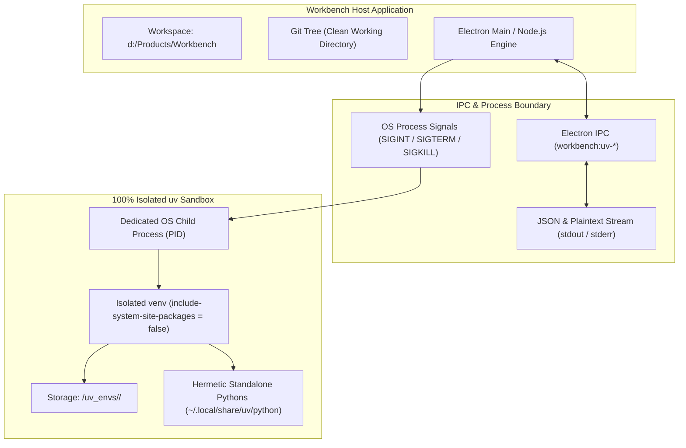
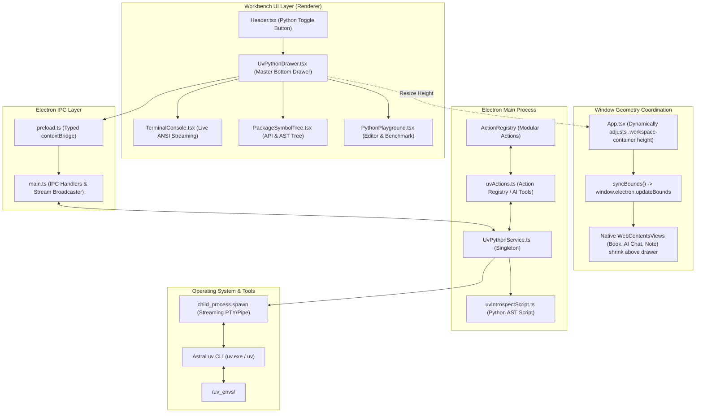

# Astral `uv` Python Package Analyzer & Live Terminal Runner

**Document:** Feature Specification & Architecture Design  
**Feature:** 100% Isolated Python Virtual Environments, AST Package Introspection & Live Terminal Execution  
**Technology Stack:** Astral `uv`, Electron 34, React 19, TypeScript 5.7, Node.js `child_process.spawn`  
**Repository Location:** `d:\Products\Workbench`  
**Target Document Path:** `docs/UV_PYTHON_PACKAGE_ANALYZER_DESIGN.md`  

---

## 1. Executive Summary

Workbench provides technical readers and developers with three embedded surfaces side by side: a **BookView** reader (O'Reilly, EPUB, MOBI, PDF), an **AI Chat** pane (ChatGPT, Claude, Gemini), and a **NoteView** / **Local Explorer** pane.

This feature introduces a dedicated **Astral `uv` Python Package Analyzer & Live Terminal Runner** implemented as a **Dockable Bottom Drawer (Option A)**. It allows users and autonomous AI assistants to:
1. **Create 100% Isolated Environments:** Provision virtual environments in milliseconds via Astral `uv` without touching or polluting host system Python or Workbench project directories.
2. **Stream Live Terminal Logs:** Watch package downloads, wheel builds, and shell commands in real time with ANSI color rendering, auto-scrolling, and process termination controls.
3. **Deeply Inspect Package APIs & ASTs:** Automatically extract package version metadata, dependencies, public classes, methods, docstrings, typed parameter signatures, and global constants.
4. **Experiment in a Code Playground:** Execute custom Python snippets and benchmarks against the isolated sandbox with timing metrics (`⚡ 32ms`) and error diagnosis.
5. **Cross-Pane Synergy:** Send any discovered method signature or class directly to the AI Chat pane for explanation, or export formatted Markdown API cards to the Note pane.

---

## 2. Total Isolation Architecture

A core requirement of this feature is that the Python sandboxes remain **completely isolated** from the Workbench desktop application and the user's project files. Isolation is guaranteed across 5 distinct architectural layers:



### 2.1 The 5 Isolation Layers

| Layer | Workbench Environment | Python Sandbox Environment | Isolation Guarantee |
| :--- | :--- | :--- | :--- |
| **1. Filesystem Location** | `d:\Products\Workbench` | `app.getPath('userData')/uv_envs/<env_id>/` | Sandboxes live in OS application data, completely separate from workspace source code. `git status` in Workbench remains 100% clean. |
| **2. Python Runtime** | Node.js / Electron JavaScript | Standalone Python 3.12 / 3.11 via `uv` | `pyvenv.cfg` generated with `include-system-site-packages = false`. Commands explicitly pass `--python "<envPath>"`. |
| **3. Multi-Sandbox Scoping** | Global Workbench settings | Per-environment timestamped folders | Different environments (e.g. `pydantic-v1` vs `pydantic-v2`) never collide or overwrite each other. |
| **4. Process & Memory** | Electron Main & Renderer PIDs | External OS Child Process PID | Code execution runs in an independent child process. Infinite loops, memory leaks, or native C-extension segfaults cannot crash Workbench. |
| **5. IPC Data Boundary** | JavaScript objects / React DOM | Raw text & JSON strings | Communication occurs solely via standard I/O streams (`stdout`, `stderr`). No Python objects cross into the JavaScript runtime. |

---

## 3. System Architecture & Component Data Flow



---

## 4. Component Details & Implementation

### 4.1 Backend Service: `electron/services/uvPythonService.ts`
The singleton class `UvPythonService` manages all interactions with `uv`:
* **Detection & Binary Resolution (`detectUv`):**
  Probes in priority order:
  1. System `PATH` (`uv.exe` or `uv`)
  2. Windows common paths: `%USERPROFILE%\.local\bin\uv.exe`, `%LOCALAPPDATA%\uv\bin\uv.exe`, `%APPDATA%\uv\bin\uv.exe`
  3. macOS/Linux common paths: `~/.local/bin/uv`, `~/.cargo/bin/uv`, `/usr/local/bin/uv`, `/opt/homebrew/bin/uv`
* **Isolated Environment Lifecycle:**
  - `createVenv(name, pythonVersion, streamId)`: Spawns `uv venv <envPath> [--python <version>]`.
  - `deleteVenv(envId)`: Recursively removes `<userData>/uv_envs/<envId>` and updates index file `workbench-uv-envs.json`.
  - `listEnvs()`: Returns all active environments with Python versions and installed packages list.
* **Streaming Process Management:**
  - `installPackage(envId, packageSpec, streamId)`: Runs `uv pip install --python "<envPath>" <packageSpec>`.
  - `executeCode(envId, code, streamId)`: Stages code into a temporary script inside the venv, executes via `uv run --python "<envPath>" python <file>`, captures exit code and duration (ms), and unlinks the script upon completion.
  - `runArbitraryCommand(envId, command, streamId)`: Runs arbitrary user commands in the active venv.
  - `killProcess(streamId)`: Sends `SIGTERM` followed by `SIGKILL` to cleanly terminate runaway or hanging processes.

### 4.2 AST Introspection Engine: `electron/services/uvIntrospectScript.ts`
A zero-dependency Python script bundled directly in TypeScript and executed via:
```bash
uv run --python "<envPath>" python -c "<script>" <package_name>
```
* **Extracted Schema:**
  ```typescript
  export interface PackageAnalysisReport {
    package: string
    metadata: {
      name: string
      version: string
      summary: string
      author: string
      license: string
      homepage: string
      dependencies: string[]
    }
    modules: Array<{ name: string; isPackage: boolean }>
    classes: Array<{
      name: string
      module: string
      docstring: string
      bases: string[]
      methods: Array<{
        name: string
        signature: string
        docstring: string
        parameters: Array<{ name: string; kind: string; annotation: string; default: string }>
        returnType: string
      }>
    }>
    functions: Array<{
      name: string
      module: string
      signature: string
      docstring: string
      parameters: Array<{ name: string; kind: string; annotation: string; default: string }>
      returnType: string
    }>
    constants: Array<{ name: string; type: string; value: string }>
  }
  ```

### 4.3 Action Registry Integration: `electron/actions/uvActions.ts`
Registers 4 first-class actions in `ActionRegistry` so autonomous AI assistants (Claude, ChatGPT, Gemini) can use the sandbox during conversations:
1. `uv_create_env`: Provisions a new isolated environment.
2. `uv_install_package`: Installs a PyPI or local package.
3. `uv_analyze_package`: Returns package metadata, classes, functions, and docstrings.
4. `uv_run_code`: Executes a Python script in the sandbox and returns stdout, stderr, and execution duration.

### 4.4 UI Components (`src/components/`)
* **`UvPythonDrawer.tsx`:** The master dockable drawer containing the resize splitter, environment picker, package installer, tab selector, and window controls.
* **`TerminalConsole.tsx`:** Streaming log viewer with lightweight ANSI-to-HTML parser, process kill button, copy buffer, and inline command input bar `(uv-sandbox) $ ...`.
* **`PackageSymbolTree.tsx`:** Filterable symbol explorer with live counts, collapsible class/method cards, docstring viewer, and 1-click **Ask AI** / **Export to Notes** buttons.
* **`PythonPlayground.tsx`:** Syntax-styled code editor with preset templates (Benchmark, Exports, Import Check), `Ctrl+Enter` execution shortcut, and execution metrics (`⚡ 32ms`, `Exit 0`).

---

## 5. UI Layout & Geometry Coordination (Option A)

Workbench hosts native `WebContentsView`s that paint directly on top of all DOM elements. To ensure native views never occlude the drawer, Option A coordinates layout geometry dynamically:

```
┌────────────────────────────────────────────────────────────────────────────────────────┐
│ APP HEADER (Logo, Pane Toggles [Book][Chat][Note], Ratio Presets, [🐍 Python uv])       │
├──────────────────────────┬──────────────────────────────┬──────────────────────────────┤
│       BOOK PANE          │        AI CHAT PANE          │          NOTE PANE           │
│   (WebContentsView)      │      (WebContentsView)       │      (WebContentsView /      │
│                          │                              │        LocalExplorer)        │
│   Height automatically   │    Height automatically      │    Height automatically      │
│   shrinks above drawer   │    shrinks above drawer      │    shrinks above drawer      │
├──────────────────────────┴──────────────────────────────┴──────────────────────────────┤
│ ═══ HORIZONTAL SPLITTER BAR (Drag to resize drawer height, double-click to snap) ═════ │
├────────────────────────────────────────────────────────────────────────────────────────┤
│ 🐍 UV PYTHON ANALYZER & TERMINAL DRAWER                                [ _ ][ □ ][ ✕ ] │
└────────────────────────────────────────────────────────────────────────────────────────┘
```

1. **Dynamic Workspace Height (`src/App.tsx`):**
   ```tsx
   <div
     className="workspace-container"
     ref={workspaceRef}
     style={
       isPythonDrawerOpen
         ? { height: `calc(100vh - var(--header-height) - ${pythonDrawerHeight}px)` }
         : undefined
     }
   >
   ```
2. **Bounds Recalculation:** When `isPythonDrawerOpen` or `pythonDrawerHeight` changes, `syncBounds()` queries `getBoundingClientRect()` on the pane anchor elements and sends the shrunk rectangles to `window.electron.updateBounds()`.
3. **Ghost Dragging:** Dragging the drawer splitter resizes smoothly between 180px and 75vh, while double-clicking snaps between 320px and 560px.

---

## 6. Operational Guide: Step-by-Step

### 6.1 Launching the Drawer
* Click the green **`Python (uv)`** button in the header, or press **`Ctrl + ` `** (backtick) from anywhere in Workbench.

### 6.2 1-Click Package Analysis
1. In the package input box, type a package name (e.g. `pydantic` or `fastapi`).
2. Click **`⚡ Install & Analyze`** (or press Enter).
3. The drawer opens the **Terminal** tab, downloads wheels, and installs the package in the sandbox via `uv pip install`.
4. The background introspection engine runs AST extraction.
5. The drawer automatically flips to the **Symbol Tree** tab, displaying the full API hierarchy.

### 6.3 Interacting with Symbols
* **Search:** Filter by class name, function name, or docstring keyword.
* **Inspect:** Expand classes to review method signatures and type annotations.
* **Ask AI:** Click **`Ask AI`** next to any symbol to forward an explanation prompt to the active AI chat pane.
* **Export to Notes:** Click **`Export to Notes`** to copy a structured Markdown card into your notes.

### 6.4 Code Experimentation
1. Switch to the **Playground** tab.
2. Select a template (*"Benchmark Speed"*, *"Inspect Symbols"*, etc.) or type custom Python code.
3. Press **`Ctrl + Enter`** to execute.
4. Review the stdout/stderr, execution time, and exit status badge.
5. If an error occurs, click **`Debug with AI`** to have the AI pane diagnose the traceback.

---

## 7. IPC Channel Specification

| IPC Channel | Type | Direction | Payload | Return / Event Data |
| :--- | :--- | :--- | :--- | :--- |
| `workbench:uv-detect` | Handle | Renderer ➔ Main | None | `{ available: boolean, version?: string, path?: string }` |
| `workbench:uv-list-envs` | Handle | Renderer ➔ Main | None | `UvEnvInfo[]` |
| `workbench:uv-create-env` | Handle | Renderer ➔ Main | `{ name: string, pythonVersion?: string, streamId?: string }` | `{ success: boolean, env?: UvEnvInfo, error?: string }` |
| `workbench:uv-delete-env` | Handle | Renderer ➔ Main | `{ envId: string }` | `{ success: boolean, error?: string }` |
| `workbench:uv-install-package`| Handle | Renderer ➔ Main | `{ envId: string, packageSpec: string, streamId?: string }` | `{ success: boolean, output: string, error?: string }` |
| `workbench:uv-analyze-package`| Handle | Renderer ➔ Main | `{ envId: string, packageName: string, streamId?: string }` | `{ success: boolean, report?: PackageAnalysisReport, error?: string }` |
| `workbench:uv-execute-code` | Handle | Renderer ➔ Main | `{ envId: string, code: string, streamId?: string }` | `{ success: boolean, output: string, stderr?: string, exitCode: number, executionTimeMs: number }` |
| `workbench:uv-run-command` | Handle | Renderer ➔ Main | `{ envId: string, command: string, streamId?: string }` | `{ success: boolean, exitCode: number, error?: string }` |
| `workbench:uv-kill-process` | Handle | Renderer ➔ Main | `{ streamId: string }` | `{ success: boolean }` |
| `workbench:uv-stream-data` | Event | Main ➔ Renderer | None | `UvStreamMessage: { streamId: string, streamType: 'stdout'\|'stderr'\|'exit'\|'status', chunk: string, exitCode?: number }` |

---

## 8. Verification & Quality Gate

* **Unit Test Suite (`test/uv_service.test.ts`):**
  - All 29 tests pass (`29/29 pass, 0 fail`).
  - Covers action discovery, alias resolution, parameter validation, AST script schema, and singleton service methods.
* **Build Verification (`npm run build`):**
  - Strict TypeScript check (`tsc`) passed with zero unused locals or type errors.
  - Vite production bundle built in 29.29s (Renderer) and 33.48s (Electron).
